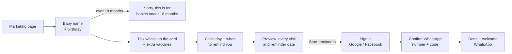
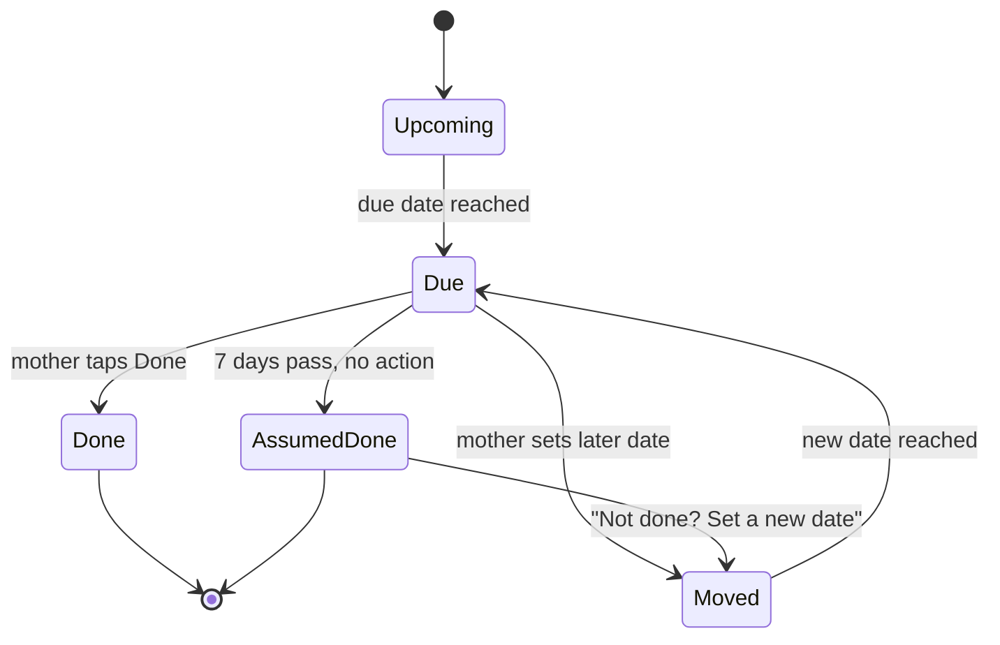
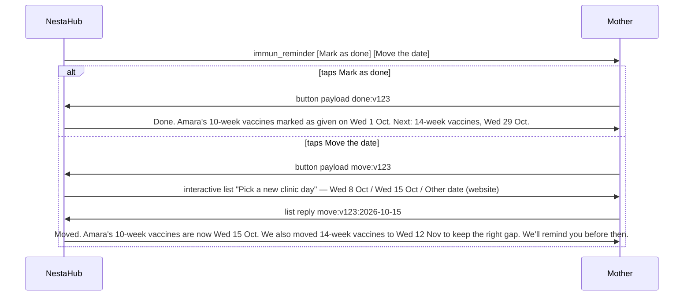

# NestaHub Baby Immunization Reminders — PRD v1

Status: draft for iteration · Last updated: 2026-09-19 · Owner: NestaHub product

---

## 1. Summary

NestaHub Reminders tells a mother, on WhatsApp, when her baby's next immunization visit is. Set-up takes under two minutes and asks for nothing until it has shown her the schedule: baby's name and birthday, any extra vaccines her hospital gives, which day her clinic runs immunization and when to be reminded, a preview of every visit — then sign in with Google or Facebook and confirm her WhatsApp number to start.

v1 is free with no tiers. It ships:

- Baby profile first (name, birthday); babies over 18 months are told the tool is for younger babies and stopped before any sign-in.
- A checklist that mirrors the immunization card — the same antigen names, in the same groups — pre-ticked from the baby's age, so a mother who has missed visits only has to untick what her card doesn't show. Optional "last visit date" and "next appointment date from the card" pin down exactly where to start. No weeks are ever asked.
- The Nigerian standard schedule (taken from the current public card) computed from birthday, snapped to the day(s) of the week her hospital runs immunization, plus a list of extra vaccines private hospitals commonly give, switched on by the mother. Both lists are configured in the admin app and seeded by script.
- A schedule preview before anything is sent.
- Sign-in with Google/Facebook and WhatsApp number verification (a 4-digit code on WhatsApp), only at the moment she taps Start.
- One WhatsApp reminder per visit, 0–7 days before the clinic day, at a time of day she picks, with two buttons: **Mark as done** and **Move the date**. Tapping Move shows her next clinic days as a tappable list; she never types and never has to open the site for these two actions.
- A web dashboard (inside a new **Utilities** tab in the bottom menu) for everything else: the full timeline, moving a single missed vaccine, extras, clinic day, settings.
- Moving a visit is free until its reminder has been sent; after that, moves are limited to 3 per baby. Every move is at most 14 days. Moving a visit also moves any later visit that would otherwise fall inside the medical minimum gap.
- No post-visit message. Seven days after a due date with no action from her, we take the visit as done.

Not in v1: SMS, calendar integration, phone-number sign-up, card photo / OCR, hospital repository, any shopping or subscription surface, delivery retries. Cost is small: about ₦10–20 per baby for the whole schedule; replies to her button taps are free (§9.5).

---

## 2. Problem and who we are building for

Mothers miss immunization visits because the only reminder they have is a paper card, and the card only speaks when they look at it. The nurse writes the next date in a small column, the card goes into a bag, and life with a newborn takes over.

Two card formats are in circulation and we have a sample of each:

- **The private-hospital card:** a grid by age (birth, 6 weeks, 10 weeks…) with vaccines per row, a signature/date column and a "next appointment" column. Everything that matters is handwritten; extras (Flu, Cholera) are squeezed into margins.
- **The public NPHCDA card:** a plain list of antigens (BCG, Hep. B0, OPV0, OPV1, PENTA1, PCV1, ROTA1, IPV1, OPV2 … Malaria 1–4, Vitamin A-1, Measles 1, Yellow Fever, Meningitis, Measles 2) with a "date given" cell beside each, a growth chart, and a next-visit date. **No ages or weeks appear anywhere on it.**

What both tell us about the conditions we design for:

- Hospitals drift from the theoretical schedule. On the private card, 10-week vaccines were given 11 Jun 2025 and 14-week not until 18 Aug 2025 — ten weeks later, not four. A birthday alone therefore does not tell us where a baby is.
- The antigen names are national and identical across formats (PENTA, PCV, ROTA, IPV, OPV, Measles, Yellow Fever). A mother can match names; she cannot tell you "which week" her baby is on.
- Hospitals run immunization on fixed weekdays, so the real visit date is the clinic day on or after the baby reaches the age.
- Private hospitals add vaccines the public schedule does not have (MMR, Chickenpox, Hepatitis A, Typhoid, Flu, Meningococcal conjugate); the public card now includes the malaria vaccine, which is being rolled out state by state.

Primary user: a first- or second-time Nigerian mother on a mid-range Android phone, living on WhatsApp, data often metered, not interested in learning a new app. She knows how to tap a big button and read a short message.

Secondary: NestaHub ops, who monitor WhatsApp delivery manually in Meta Business Manager and the existing notification log.

Why WhatsApp: it is the channel she already reads; delivery and read receipts tell us whether the message landed; and the infrastructure already exists in `nestahub-api/src/app/whatsapp` (Meta Cloud API, webhook, notification log). Phone-calendar routes were tested and rejected: Android needs a hidden sync toggle for new calendars, iPhone shows a Google calendar only if that Google account is on the phone, `.ics` files cannot be updated once added, and none of them tell us whether the reminder was seen.

---

## 3. Goals, non-goals, metrics

### Goals

1. A mother can set up reminders in under two minutes on a mid-range Android over 3G.
2. Every reminder is for a real upcoming clinic day, adjusted for what she told us.
3. She never has to open the site after set-up. Done and Move are two taps inside WhatsApp; the site is for everything else.
4. Reminders feel like they come from a caring, competent friend, not from a shop.

### Non-goals (v1)

- SMS or calendar delivery.
- Phone-number sign-up.
- Medical advice or vaccine information content. We link to the NPHCDA schedule and stop.
- Card photos, OCR, hospital repository.
- Multiple caregivers per baby.
- Any product, subscription or shopping surface inside the reminder feature.
- Ops dashboards; ops monitors WhatsApp manually. (Admin *does* get a schedule-configuration page, §11.)

### Success metrics (90 days after launch)

| Metric | Definition | Target |
| --- | --- | --- |
| Activation rate | Started sign-up → first reminder scheduled | 70% |
| Time to activate | Median seconds landing → first reminder scheduled | < 120 s |
| Delivery rate | WhatsApp reminders delivered / sent | 95% |
| Read rate | Reminders read (Meta read receipt) / delivered | 80% |
| Schedule kept true | Visits marked done or moved by the mother (WhatsApp or web) / visits due | 50% |
| Button tap rate | Reminders where she tapped Mark as done or Move / reminders read | 40% |
| Move rate | Visits moved (whole or single vaccine) / visits due | tracked |
| Unreachable rate | Babies whose WhatsApp delivery failed twice | < 3% |
| Opt-out rate | Babies paused or removed by the mother | < 5% / month |

Activation and schedule-kept-true are reviewed weekly. Because we assume visits happened, schedule-kept-true is the only read on whether the schedule still matches reality.

---

## 4. Product principles

1. **Birthday is the only thing we truly need.** Everything else has a default.
2. **WhatsApp tells her and takes the two quick answers; the web holds everything else.** She never types into WhatsApp — she taps a button. Done and Move live on the message; the timeline, single-vaccine moves, extras and settings live on the dashboard, so she still sees the rest of NestaHub when something needs more than a tap.
3. **Standard first, extras by toggle.** Start from the national schedule; she switches on what her hospital adds.
4. **Reality beats the calendar, when she tells us.** A date she sets always wins over the computed one. If she says nothing, we assume the visit happened.
5. **Bounded cost.** Every reminder is a paid WhatsApp message. Limits on moves and extras exist to keep cost predictable, and are shown plainly.
6. **One message, one thing.** Baby's name in every message; plain names ("5-in-1") with medical names beneath on the web.
7. **Cheap on data.** Pages under 200 KB; native selects, no calendar widgets.
8. **Fail towards safety.** If we cannot deliver, we say so on the dashboard and point to support; we never guess a new channel.

---

## 5. Entry points and navigation

### Bottom menu (mobile)

`src/components/layout/MobileNav.tsx` changes from Home · Shop · Gifting · Contact · Account to:

**Shop · Gifting · Utilities · Contact · Account**

Home is removed from the bottom bar (still reachable via the logo). Icon: `Wrench` from Lucide. Inner pages use the app's "page header standard style" (title + one-line subline, no top bar), as Gifting and Contact do.

### Desktop header

`DesktopHeader.tsx` gains a **Utilities** link after Gifting.

### Routes

- `/utilities` — the hub (§16). Tapping **Immunization Reminders** on mobile opens a **bottom drawer** with a short overview (what it does, the three steps) and one CTA, **Set up reminders**; a signed-in mother with a baby is taken straight to the dashboard instead.
- `/utilities/immunization` — the dashboard (`/utilities/immunization/dashboard/:babyId` for a second baby) and the wizard at `/utilities/immunization/setup`.
- `/immunization-reminders` — the **landing page** for ads, the WhatsApp broadcast and search. It has its own URL and is not linked from the Utilities hub.
- Future utilities follow the same pattern (`/utilities/diaper-calculator`).

### Routing rules

| Where | Signed out | Signed in, no baby | Signed in, has a baby |
| --- | --- | --- | --- |
| Utilities hub → Immunization (mobile) | Overview drawer → wizard | Overview drawer → wizard | Dashboard |
| Utilities hub → Immunization (desktop) | Landing page | Landing page | Dashboard |
| `/immunization-reminders` | Landing page | Landing page | Landing page with a **My reminders** button |

### Other entry points

- Account hub (`pages/Account.tsx`): menu row **Immunization Reminders**, placed first.
- Home page banner under the hero: "Free immunization reminders on WhatsApp — Set up". Dismissible.
- A WhatsApp broadcast link to existing customers at launch, pointing at the landing page.

---

## 6. User journey

The wizard asks for nothing personal until it has shown the mother her baby's schedule. Sign-in and WhatsApp verification happen last, at the moment she taps Start, so a mother whose baby is too old, or who is just looking, never creates an account or receives a code.

A signed-in mother with a verified WhatsApp number goes from E straight to H. Adding a second baby from the dashboard runs B–E and then saves directly.

**Resuming an unfinished set-up.** Every field she enters on screens 2–5 is saved as she goes, so she can leave and pick up where she stopped with each screen prefilled:

- **Signed out:** a draft in `localStorage` (`immun.setupDraft`, with the wizard version and a timestamp), kept for **7 days**. It survives closing the browser and the OAuth round-trip. Opening the wizard again within 7 days shows a banner at the top of **screen 2 (Your baby)** — "Continue setting up Amara's reminders? You stopped at step 2." with **Continue** (opens the last screen she was on); filling in screen 2 afresh discards it. After 7 days it is discarded.
- **Signed in:** the same draft is also written to the server (`SetupDraft`, one per user, upserted on every screen change), so it follows her to another phone or after a cleared browser. On sign-in, a server draft newer than the local one wins. It is deleted when the baby is created or when she taps Start over, and expires after 7 days.
- Nothing in a draft is a baby; drafts never generate reminders and are not shown on the dashboard.

### Screen 1 — Entry: Tools drawer or landing page

From the Utilities tab: a bottom drawer with the tool's name, "We work out every immunization appointment from your baby's birthday and send you a WhatsApp message to remind you before each one.", the three steps (birthday · clinic day and reminder time · "Get a WhatsApp message ahead of every appointment"), and **Set up reminders**. Nothing under the button. From `/immunization-reminders`: the landing page (§17). Both open screen 2.

### Screen 2 — Your baby

- Subline: "We use the birthday to work out every visit."
- **Baby's name** (first name enough), **Date of birth** (three native selects), optional **Boy / Girl**.
- Live line under the birthday: "Amara is 9 weeks old. Next: 10-week vaccines."
- **Gate:** if the baby is over 18 months, the button is replaced with: "Amara is past the visits we remind about. This tool is for babies under 18 months. If you have a younger baby, add them instead." No sign-in, no code. (18 months is where the standard schedule ends; the 2-year extras alone are not worth a set-up.)
- Button: **Continue**.

### Screen 3 — Tick what's on Amara's card (step 2 of 6)

The one screen that fixes where the baby actually is. It is built to be compared against the card in her other hand, so it uses the card's own antigen names and groups, never ages or weeks.

- Copy: **"Tick what Amara has already had. Check her card — the names match."**
- A checklist grouped the way the card groups them, every row showing the card name first and our plain name second:
  - *At birth:* BCG · Hep. B0 · OPV0
  - *6 weeks:* OPV1 · PENTA1 (5-in-1) · PCV1 (pneumonia) · ROTA1 (rotavirus) · IPV1 (polio injection)
  - *10 weeks:* OPV2 · PENTA2 · PCV2 · ROTA2
  - *14 weeks:* OPV3 · PENTA3 · PCV3 · ROTA3 · IPV2
  - *6 months:* Vitamin A 1st dose
  - *9 months:* Measles-Rubella 1 (MR1) · Yellow Fever · Meningitis · Vitamin A 2nd dose
  - *15 months:* Measles-Rubella 2 (MR2)
  - *Malaria (if your hospital gives it):* Malaria 1 (5 months) · Malaria 2 (6 months) · Malaria 3 (7 months) · Malaria 4 (15 months)

  The age headings are for grouping only; the public card shows names without ages, so the names are what she matches.
- **Pre-ticked from her age:** every vaccine whose age date is before today starts ticked. A newborn sees nothing ticked and taps Continue. A baby on schedule needs no change. A baby that is behind: she unticks what the card doesn't show. A group-level tick ticks/unticks the whole visit.
- **Kept short:** only groups up to and including the next due visit are expanded; everything after collapses into one "Later visits — nothing to tick yet" row. The birth group is one row. This keeps the list to a screen for most babies.
- **The Continue button is fixed to the bottom** of the screen, always visible. While the list extends below the fold the footer carries a one-line hint above the button — "More options below" with a down arrow.
- The extras and the two optional dates are **separate screens** (steps 3 and 4 below), so this screen is only the checklist.
- ~~Under the list, two optional fields~~ Step 4 asks two optional dates:
  - **"When was the last visit?"** — "the date written next to the last vaccine she had" (three native selects). Used for the minimum gap to the next visit.
  - **"Is there a next appointment date on the card?"** — "some cards have a 'next date' box" (three native selects). If given, it becomes the next visit's date outright.
- Step 3, **"Does your hospital also give these?"** — the extras toggle list (§7.2), all off, with **Skip for now**.
- Live line at the bottom, updating as she ticks: "Next: 10-week vaccines (OPV2, PENTA2, PCV2, ROTA2)." or "Next: ROTA2 catch-up, then the 14-week vaccines."
- Button: **Continue**. Nothing here is mandatory beyond the ticks she chooses to change; everything is editable later from the dashboard.

### Screen 4 — Clinic day and when to remind you (step 5 of 6)

Hospitals run immunization on fixed days of the week, so the day that matters is the clinic day on or after the baby reaches the age, not the age date itself.

- **"Which day does your hospital do immunization?"** Seven day chips, multi-select — "Tick more than one if your clinic gives vaccines on multiple days." **Not sure / any day** is the fallback and means no snapping.
- **"When should we remind you?"** Chips: **1 week before** · **3 days before** · **1 day before** (default) · **Other** → "__ days before" (0–7; 0 = on the day). The offset counts back from the clinic day, never from the age date.
- Time: native time input, default 08:00. Allowed 06:00–21:00 Africa/Lagos.
- Button: **Continue**.

### Screen 5 — Preview: here is what we'll send (step 6 of 6)

- The full list with real dates. Each row leads with a **date block** (weekday / day / month) for the appointment day — tan-filled for the next one, muted for later ones, grey "Done" for past ones — so the appointment date reads first; the reminder sits beneath in smaller sage text with a bell icon ("Reminder Tue 30 Sep, 8:00"). A one-line legend above the list explains the two. Total line: "9 reminders over the next 2 years."
- Caveat, in plain words, above the button: **"If a visit date changes or looks wrong, come back here any time and change it — we'll adjust the reminders."**
- **Edit** links back to screens 2–4 without losing anything.
- Button: **Start reminders**. If signed in with a verified number, this saves and goes to Done; otherwise it opens screen 6.

### Screen 6 — Sign in

- Existing `SignInForm` with Google and Facebook, headed "Sign in to start Amara's reminders". No phone-number sign-up in v1.
- On return from OAuth the wizard state is restored from the draft and continues to screen 7.

### Screen 7 — Lastly, confirm your WhatsApp number

Two states on one screen:

1. **Number.** Heading "Lastly, confirm your WhatsApp number"; the 🇳🇬 +234 prefix and the number, pre-filled from the account; CTA **Send code on WhatsApp**.
2. **Code.** Heading "Enter the code we sent", the number shown with a **Wrong number?** link back, four code boxes, **Resend** after 30 s, and CTA **Confirm and start reminders**.

- We send a 4-digit code with the `immun_auth` WhatsApp template.
- Two send attempts in total. If neither is delivered: "We couldn't reach this number on WhatsApp. Check the number, or contact support." with a **Contact support** button (opens `/contact` pre-filled). No SMS.
- Correct code marks the number verified, saves the baby and schedule, and goes to Done. This is the only number reminders go to.

### Screen 8 — Done

- Big tick. "Amara's reminders are on." Card: 10-week vaccines · Wed 1 Oct (clinic day) · We'll message you Tue 30 Sep at 8:00.
- One line beneath: "If a visit moves, change the date here and we'll adjust. Otherwise we'll assume it went well."
- Buttons: **See Amara's schedule** (dashboard), **Add another baby**.
- Simultaneously, a welcome WhatsApp arrives: "Hi Chioma, Amara's immunization reminders are on. Next: 10-week vaccines, Wed 1 Oct. Manage reminders any time at nestahub.com/utilities/immunization." Receiving the message while looking at the screen is the delight moment; it proves the channel works.

---

## 7. Schedule engine

### 7.1 Standard schedule (default rows)

Taken from the NPHCDA Routine Immunisation Schedule (the table reproduced for this PRD) and cross-checked against the public card's antigen list. Lives in the database, editable in the admin app (§11), seeded from the table below by `scripts/seed-immunization-schedule.ts`. Card names are stored alongside plain names so the checklist (screen 3) reads like the card. Visits are named by age everywhere ("10-week vaccines"), matching how the schedule and private cards label them.

| # | Age | Plain name shown | Card names → plain names | Min gap from previous visit |
| --- | --- | --- | --- | --- |
| 1 | At birth | Birth vaccines | BCG · OPV0 (polio drops) · Hep. B0 (hepatitis B) | — |
| 2 | 6 weeks | 6-week vaccines | PENTA1 (5-in-1) · PCV1 (pneumonia) · OPV1 (polio drops) · IPV1 (polio injection) · ROTA1 (rotavirus) | — |
| 3 | 10 weeks | 10-week vaccines | PENTA2 · PCV2 · OPV2 · ROTA2 | 28 days |
| 4 | 14 weeks | 14-week vaccines | PENTA3 · PCV3 · OPV3 · ROTA3 · IPV2 | 28 days |
| 5 | 6 months | 6-month visit | Vitamin A 1st dose | — |
| 6 | 9 months | 9-month vaccines | Measles-Rubella 1 (MR1) · Yellow Fever · Meningitis · Vitamin A 2nd dose | — |
| 7 | 15 months | 15-month vaccines | Measles-Rubella 2 (MR2) | 28 days after MR1 |

The malaria vaccine (marked ** on the schedule: 5, 6, 7 and 15 months) is being rolled out state by state, so it lives in the extras list, off by default, with the note "tick if your hospital gives it". When toggled, Malaria 2 joins the 6-month visit and Malaria 4 the 15-month visit; Malaria 1 and 3 add visits at 5 and 7 months, each with a 28-day minimum gap from the previous malaria dose. HPV at 9 years is outside the tool's range.

### 7.2 Extra vaccines (toggle list, off by default)

Maintained by NestaHub in the admin app, not editable by mothers. Seeded from the table below; extend as we see more cards.

| Age | Extra | Notes |
| --- | --- | --- |
| 5 / 6 / 7 / 15 months | Malaria 1 · 2 · 3 · 4 | On the national schedule (**) and the newer public card; phased rollout by state. One toggle adds all four; 28-day gap between doses. |
| 6 months | Flu | Hand-added on the private sample card |
| 12 months | Meningococcal conjugate (ACWY) | Sample card gives it at 12 m; public schedule gives MenA at 9 m |
| 12 months | Measles 2 (early) | Private sample card gives Measles 2 at 12 m instead of 15 m; toggling this moves row 7's Measles 2 to 12 m |
| 15 months | MMR 1, Chickenpox 1 | |
| 18 months | MMR 2, Chickenpox 2, Hepatitis A 1 | Min gap 28 days after 15-month |
| 2 years | Typhoid, Hepatitis A 2 | HepA 2 min gap 168 days after HepA 1 |

Each toggled extra becomes a visit row (or joins an existing row at that age) and costs one reminder. No free-text "other" in v1. Cholera is deliberately left off the list.

### 7.3 Computing dates

- `age_date = date_of_birth + age_offset` (weeks or months; month arithmetic clamps to month end).
- `due_date = first clinic day on or after age_date`, using the baby's `clinicDays` (one or more weekdays). With no clinic day set, `due_date = age_date`, Sundays moved to Monday.
- Example: born Fri 18 Jul → 10 weeks is Fri 26 Sep; clinic day Wednesday → due Wed 1 Oct. Reminder "1 day before" at 08:00 → Tue 30 Sep 08:00.
- A date the mother set (`moved_to_date`) replaces `due_date` for that visit. The move picker only offers her clinic days (or any day if none set).
- Minimum gaps (§7.4) are checked against `due_date`, and the required date is itself snapped forward to the next clinic day.

### 7.4 Moves and the cascade rule

A mother can **move a visit** to a later date, or **move a single vaccine** out of a visit (it becomes a catch-up row with its own reminder).

- **Free before the reminder, counted after.** Moving a visit whose reminder has not yet been sent costs nothing and is unlimited; it is just correcting the plan. Moving a visit *after* its reminder has gone out counts against a limit of **3 counted moves per baby** (whole-visit and single-vaccine alike), because each one costs a second message. The counter is shown only once it matters ("1 of 3 changes used"). At 3 the button explains and points to Contact Us; ops can reset.
- A move may be at most **14 days** later than the visit's current date.
- Marking done never counts as a move.

**Cascade.** After a move, walk forward through later visits in order. For each, `required = previous_visit_date + min_gap`, snapped to the next clinic day. If the visit's date is earlier than `required`, set it to `required` and continue; otherwise stop. Cascaded moves never count against the allowance, regenerate that visit's reminder, and are highlighted on the dashboard. No message is sent for a move or a cascade; the next reminder simply carries the new date.

Example (clinic day Wednesday): 10-week moved from Wed 1 Oct to Wed 15 Oct (+14 d). 14-week was Wed 29 Oct; required = 15 Oct + 28 d = Wed 12 Nov → moved to 12 Nov. 6-month visit has no min gap → untouched. Cascade stops.

### 7.5 Single-vaccine catch-up

- "Missed? Move it" on a vaccine creates a catch-up row: name "Rotavirus catch-up", date she picks (≤ 14 days out, a clinic day), one reminder at her usual setting.
- The parent visit is Done for the vaccines given. The catch-up does not trigger a cascade.

### 7.6 Assume-done rule

We never message after a visit. Seven days after a visit's due date, if she has not marked it or moved it, it becomes **Assumed done** with the due date. Seven days rather than three so that a mother who goes "next clinic day" without telling us is still covered. Later visits keep their computed dates. The dashboard shows "Assumed done · Not done? Set a new date"; that link reopens it as a move (counted, since the reminder was sent).

### 7.7 Finding the starting point (babies who are not newborn at sign-up)

A birthday alone does not say where a baby is, because missed visits shift everything after them. The starting point comes from the screen-3 checklist plus two optional dates, resolved in this order:

1. **What has been given.** Every vaccine ticked on the checklist is Done (`doneSource = signup`, `doneDate = lastVisitDate` if she gave one, else null). A visit whose vaccines are all ticked is Done. A visit with some vaccines unticked is Done for the ticked ones, and each unticked vaccine becomes a **catch-up row** (§7.5) due at the next visit — a mother who missed ROTA2 gets "ROTA2 catch-up" alongside the 14-week vaccines, not a lost dose.
2. **The next visit** is the first visit with nothing ticked.
3. **Its date** is, in priority order:
   - the **next appointment date from the card**, if she entered one (the nurse's date wins, whatever we would have computed);
   - otherwise `max(age_date, last_visit_date + min_gap)` — the later of "when she's old enough" and "long enough since the last dose" — snapped to her clinic day. If she gave no last-visit date, `age_date` alone;
   - if that lands in the past (she's behind and gave no dates), the next clinic day from today.
4. **Everything after** the next visit is age-bound from the birthday as usual; the cascade rule (§7.4) keeps the minimum gaps if the next visit's date pushes them.

Worked example: born 18 Jul; today 19 Sep (9 weeks). Pre-ticked: birth group and 6-week group. She unticks ROTA1 (clinic was out of stock) and enters last visit 3 Sep, no next date. Result: 6-week visit Done except ROTA1 → "ROTA1 catch-up" due with the 10-week vaccines; 10-week visit = max(age 10 weeks = 26 Sep, 3 Sep + 28 d = 1 Oct) = Wed 1 Oct (clinic day). 14-week visit stays at Fri 24 Oct → Wed 29 Oct; gap from 1 Oct is 28 days, so no cascade.

If the next visit is already overdue when she signs up, the welcome message says: "Amara's 10-week vaccines look overdue. Tap Move the date on your next reminder, or update it at nestahub.com/utilities/immunization." and the reminder goes out the next morning. The assume-done rule then applies seven days later. Babies over 18 months are stopped at screen 2 and never reach this point.

**Why not a photo.** A snap of either card would only ever pre-tick this checklist; the checklist is the source of truth. Card layouts vary, but the antigen names are national, so the checklist is more robust than OCR and costs nothing. If OCR is added in v1.1 it feeds this screen.

---

## 8. Accommodating hospital differences without a card photo

### Public card vs the sample private card

| Age | Public NPHCDA card (our standard) | Sample private card | Difference type |
| --- | --- | --- | --- |
| Birth | BCG, Hep. B0, OPV0 | Hepatitis B, OPV, BCG | none |
| 6 weeks | OPV1, PENTA1, PCV1, ROTA1, IPV1 | OPV, Penta, Rota, PCV | private card lacks IPV1 here |
| 10 weeks | OPV2, PENTA2, PCV2, ROTA2 | OPV, Rota, Penta, PCV | none |
| 14 weeks | OPV3, PENTA3, PCV3, ROTA3, IPV2 | OPV, Penta, PCV, IPV | private card lacks ROTA3 |
| 5 / 7 months | Malaria 1, Malaria 3 (where rolled out) | — | public-only, phased |
| 6 months | Vitamin A-1 (+ Malaria 2) | Vitamin A (+ Flu, handwritten) | extra at same age |
| 9 months | MR1, Yellow Fever, Meningitis, Vitamin A 2nd dose | Measles, Yellow fever | private card lacks Meningitis and Vitamin A |
| 12 months | — | Meningococcal conjugate, Measles 2, Vitamin A (+ Cholera, handwritten) | extra at same age; Measles 2 earlier |
| 15 months | MR2 (+ Malaria 4) | MMR, Chickenpox | different vaccines at same age |
| 18 months | — | MMR, Chickenpox, Hepatitis A | extra visit |
| 2 years | — | Typhoid, Hepatitis A | extra visit |

Every difference is one of three kinds — an extra vaccine at an existing age, an extra visit at a later age, or the same vaccine at a different age — and all three are covered by the toggle list in §7.2 with no OCR and no free text. Where a private card *lacks* a public vaccine (IPV1 at 6 weeks, ROTA3), the mother simply leaves it unticked on screen 3 and it becomes a catch-up she can dismiss from the dashboard, or it is offered at the next visit; the standard is the public schedule.

### OCR, if we want it later

A single vision-model call reading only the printed grid and returning which toggles to switch on costs roughly ₦15–30 per card; no free service handles this layout and handwriting well. Proposed for v1.1 as "Snap your card to pre-fill", limited to 2 snaps per baby.

---

## 9. WhatsApp messages

### 9.1 Templates

Meta requires pre-approved templates for business-initiated messages. Parameter order is fixed at approval. Parameters cannot contain newlines (the gift-card service already sanitises this). Submit all three in the first week of the build.

| Template | When | Body |
| --- | --- | --- |
| `immun_auth` | Verifying the number | Meta standard authentication template with the 4-digit code |
| `immun_welcome` | After set-up | Hi {{1}}, {{2}}'s immunization reminders are on. Next: {{3}}, {{4}}. Manage reminders any time at nestahub.com/utilities/immunization. |
| `immun_reminder` | Once per visit at her chosen offset and time | Body: Hi {{1}}, {{2}}'s {{3}} is {{4}}. Remember to take the immunization card. · Footer: Manage at nestahub.com/utilities/immunization · Buttons: **Mark as done** · **Move the date** |

Parameters: {{1}} mother's first name, {{2}} baby's name, {{3}} visit or catch-up plain name, {{4}} date as "Wed 1 Oct". The two buttons are Meta *quick-reply* buttons: tapping one sends us a payload we set at send time (`done:<visitId>` / `move:<visitId>`) and opens a free 24-hour service window. Quick-reply buttons keep the template in the utility category.

### 9.2 The two button flows

Everything after a tap happens inside the 24-hour window, so it is free and needs no template. The visit id travels in the payload, so the flows are stateless.

**Mark as done**

- Sets `doneDate = due_date` (the planned clinic day), not the tap date. A tap on a reminder sent a week early therefore means "this is going ahead as planned", which is the same outcome as assume-done, just confirmed; a tap on or after the day means it happened. Re-anchoring uses that date.
- Confirmation names the next visit and its date. If there is none: "That was Amara's last scheduled visit. Thank you for keeping her protected."
- Tapping Done on a visit already Done or Assumed done: "Already marked done. Next: …" — idempotent.

**Move the date**

- We reply with a WhatsApp **interactive list** (header "Pick a new clinic day"): her clinic days within the 14-day limit, one row each, dated ("Wed 8 Oct", "Wed 15 Oct"), plus a final row **Other date or a single vaccine → website**. With no clinic day set, the next 9 days are offered (list limit is 10 rows).
- Her pick applies exactly the web move rules: this reminder has been sent, so it is a **counted move** (1 of 3); cascade runs; unsent reminders regenerate; a new reminder is scheduled for the new date at her usual offset.
- Confirmation lists any cascaded visits in plain words. If the allowance is used up, the reply says so and links to Contact Us; nothing changes.
- The list message expires with the 24-hour window. A pick after that returns "This has expired — open the message again or move it at nestahub.com/utilities/immunization."

**Taps on old messages.** A button on last month's reminder still works; we act on the visit's current state and reply with it. The tap also opens a fresh 24-hour window.

### 9.3 Typed replies

Messages never ask her to type and never mention STOP; the buttons are the whole interface. Typed text is still handled:

- `STOP` / `PAUSE` → pause reminders for that number, reply once "Reminders paused. Turn them back on at nestahub.com/utilities/immunization." Honoured for safety and Meta quality rating; not advertised.
- Anything else → reply once within the free 24-hour window: "Thanks! Use the buttons on the reminder, or manage Amara's reminders at nestahub.com/utilities/immunization." Logged for review.

### 9.4 Sending rules

- Send at her chosen time, Africa/Lagos. Allowed window 06:00–21:00.
- One reminder per visit. Skipped if the visit is marked done first. If a move lands the new date inside her offset (she chose "1 week before" but moved it to 3 days away), the reminder goes the next morning at her chosen time. A counted move (after the reminder went out) schedules one new reminder for the new date.
- Delivery failure: **no retry.** The send is recorded failed; the dashboard row shows "Reminder not delivered — check your WhatsApp number". Two consecutive failed sends flag the baby **unreachable** with a banner: "We couldn't deliver to 0801…. Check the number or contact support." No SMS.
- Every send goes to the existing notification log with template, visit id, Meta message id and status (sent / delivered / read / failed, from the webhook); button taps and list picks are logged against the same visit. Ops monitors volume and quality manually in Meta Business Manager.

### 9.5 Cost

Meta bills per delivered template message (since July 2025). Nigeria utility rate $0.0067–0.0101; authentication $0.0067 (the NestaHub WhatsApp Business number is registered in Nigeria, so the domestic rate applies). Everything we send inside the 24-hour window her tap opens — confirmations, the date list — is free.

| Per baby, to 18 months (+ 2-year extras where toggled) | Paid messages |
| --- | --- |
| OTP | 1 |
| Welcome | 1 |
| Reminders (8 standard + ~1–2 extras) | ~9–10 |
| Re-sent reminders after counted moves (≤ 3) | ~1 |
| Done / Move confirmations and date lists | 0 |
| **Total** | **~12–13** |

500 babies ≈ 5,000 paid messages a year ≈ **$34–51 a year (₦50k–76k at ₦1,500/$)**, about ₦4–6k a month. The buttons add nothing to this. Restoring three reminders per visit would roughly triple it. Cost is not a constraint at this scale; the move and extras limits exist to keep it predictable.

---

## 10. Dashboard (`/utilities/immunization`, mobile-first)

One screen, no scrolling for most mothers. Page header with a **back button to the Utilities hub** and the title "Immunization Reminders". Beneath it a **baby switcher**: one prominent chip per baby (avatar initial, name and age — "Amara · 9 weeks"), the selected one highlighted, plus a dashed **+ Add baby** chip. Toggling a chip switches every card and drawer below to that baby.

- **Next appointment card:** the appointment date is the hero — a large tan **date block** (weekday / day / month) on the left; beside it the visit name, vaccines (plus any catch-up), and a **bell-icon** reminder line "Reminder Tue 30 Sep, 8:00" (a small tick once delivered/read; a warning if not delivered); then two buttons, **Mark as done** · **Move the date** — the same two actions as the WhatsApp buttons, sharing one implementation. The "1 of 3 changes used" counter appears only once the reminder has been sent. If the next visit is Assumed done, the card says so with "Not done? Set a new date".
- **Management rows** (the Account page's `MenuRow` pattern), each opening a **bottom drawer**:

| Row | Sub-line | Drawer |
| --- | --- | --- |
| Schedule | "2 of 9 appointments done · next Wed 1 Oct" | The full timeline, each row led by its **date block** so future dates stand out (tan for the next, muted for later, grey "Done" for past); vaccine names beneath; catch-ups nest under their parent; cascaded moves carry a "moved to keep the 4-week gap" note. Tapping a future visit opens the Move drawer for it. |
| Extra vaccines | what's on | The §7.2 toggles; **Save** regenerates undone visits. |
| Clinic day | "Wednesday" | Seven day chips + Not sure; **Save** snaps undone visits, no move counted. |
| Reminder settings | "1 day before · 8:00" | 1 week / 3 days / 1 day / Other + time; **Save** applies to unsent reminders. |
| WhatsApp number | "+234 801… · verified" | Number field; **Send code to new number** runs the verification step; reminders switch only after the code is confirmed. |
| Pause reminders | — | Confirmation drawer: schedule kept, nothing deleted, resume any time. |
| Remove Amara | — | Destructive confirmation: deletes the schedule and every future reminder at once. |

- Single-vaccine moves ("Missed? Move it") are **not** in the v1 dashboard; a vaccine missed at a visit is captured at set-up (unticked → catch-up) and otherwise handled by moving the whole visit. Per-vaccine moves are a v1.1 candidate if the pilot asks for them.
- Footer: link to the NPHCDA schedule and "Always follow your hospital's advice."
- No shopping, subscription or product content on this page in v1.
---

## 11. Integration with the current apps

### Web UI (`nestahub-web-ui`)

| Surface | Change |
| --- | --- |
| Routes (`App.tsx`) | `/utilities` (hub), `/utilities/immunization` (dashboard + routing), `/utilities/immunization/setup` (wizard), `/utilities/immunization/dashboard/:babyId`, `/immunization-reminders` (landing page). Above the catch-all. |
| Bottom nav (`MobileNav.tsx`) | Shop · Gifting · Utilities · Contact · Account. Home removed from the bar. |
| Desktop header | Utilities link after Gifting. |
| Account hub | Immunization Reminders row, first. |
| Utilities hub | `pages/Utilities.tsx` with `components/utilities/UtilityCard` (live / coming-soon variants) driven by a static config (§16). |
| Sign-in | `SignInForm` unchanged (Google/Facebook), shown at the end of the wizard. New `WhatsAppVerifyStep` after sign-in, reusing `PhoneStep` styling. |
| Set-up draft | `hooks/useSetupDraft.ts`: writes every wizard change to `localStorage` (7-day TTL, versioned) and, when signed in, debounced to `PUT /setup-draft`. Restores on mount, across the OAuth round-trip (`auth_redirect_url` already brings her back to the wizard), and on a new device after sign-in. Drives the "Continue setting up…" banner on the marketing page. |
| New components | `components/reminders/`: `MarketingPage`, `BabyForm` (with the 18-month gate), `CardChecklist` (screen 3: card names, group ticks, age pre-ticks, the two optional dates), `SchedulePreview` (screen 5 and the dashboard), `ExtrasToggleList`, `ClinicDayPicker`, `ReminderTimePicker`, `ScheduleTimeline`, `VisitRow`, `MoveDateDrawer`, `UnreachableBanner`. Drawer-based edits like `ProfileEditDrawer`. |
| Hooks / API | `hooks/useBabies.ts`, `hooks/useSchedule.ts` on React Query; functions in `lib/api.ts`. |
| Analytics | Vercel Analytics + Meta Pixel events per wizard step, Done, Move. |
| Design | No new colours. Done = sage, Assumed done = muted sage, Due = tan, Moved/Upcoming = neutral. |

### Auth

- Identity stays Supabase (Google/Facebook). No phone sign-up, so no Supabase phone auth or SMS hook.
- WhatsApp verification is NestaHub's own: `PhoneVerification` row with hashed 4-digit code, 10-minute expiry, 3 wrong-code attempts, 2 send attempts per verification. Delivered with `immun_auth`. Success sets `User.phoneVerifiedAt` and `User.phone`.
- A phone on file from orders is not a verified WhatsApp number; verify once.

### API (`nestahub-api`)

- New module `app/immunization/`: `babies`, `schedules` (rows + extras from the DB, date computation, cascade), `visits`, `reminders`, `verification` services; cron `reminder-dispatch` (every 15 min: send due reminders, apply assume-done); keyword handler registered with the existing WhatsApp webhook.
- `WhatsAppService`: add `sendTemplate(name, to, params, buttonPayloads?)` (quick-reply payloads are passed as button components at send time), `sendText(to, body)` and `sendInteractiveList(to, header, body, rows[])`; document the new template in the same header comment style as the gift-card ones.
- Inbound webhook: today it receives delivery statuses; extend it to (a) record `delivered` / `read` / `failed` on `ReminderSend`; (b) handle `messages[].type = "button"` (template quick reply → `button.payload`) and `type = "interactive"` with `interactive.type = "list_reply"` (→ `list_reply.id`), dispatching `done:<visitId>`, `move:<visitId>` and `move:<visitId>:<date>` to the same `VisitsService.markDone` / `move` the web uses; (c) route free text to a small `KeywordRouter` (STOP/PAUSE, fallback). Payloads are verified to belong to the sending phone's user before acting.
- Meta's webhook can deliver the same event twice; handlers are idempotent (Done twice is Done; a repeated list pick for an already-moved visit replies with the current state).
- Standard schedule and extras live in two tables (`ScheduleRow`, `ExtraVaccine`), seeded by `scripts/seed-immunization-schedule.ts` from the tables in §7.1 and §7.2 (idempotent, upserts by key). Editing a row affects babies created afterwards and any undone visit of existing babies on the next regeneration; done visits are never touched.
- Ops uses the notification log and Meta Business Manager for delivery; move-counter resets and unreachable checks are done with a short script or direct DB access in v1.

### Admin UI (`nestahub-admin-ui`)

One page, **Immunization schedule**, under Settings:

- **Standard rows** table: order, age (value + unit: days / weeks / months), plain name, vaccines (chips), min gap days, active. Inline edit, add, reorder, deactivate (never hard-delete; existing visits reference the row key).
- **Extra vaccines** table: key, age, plain name, vaccines (chips), notes, min gap days, active.
- A **Preview** panel: enter a birthday and clinic day, see the generated schedule — the same function the wizard uses, so ops can sanity-check an edit before saving.
- Audit: who changed what, when (existing admin audit pattern).
- Guarded by the existing admin JWT.

---

## 12. Data model and API

### Prisma models

`User` gains `phoneVerifiedAt`.

| Model | Key fields | Notes |
| --- | --- | --- |
| `ScheduleRow` | id, key (`birth`, `w6`, `w10`…), order, ageValue, ageUnit (days / weeks / months), plainName, vaccines JSON `[{cardName, plainName}]`, minGapDays, active, updatedBy | Admin-editable; seeded. `cardName` is what the checklist shows first |
| `ExtraVaccine` | id, key (`malaria`, `flu_m6`, `mmr_m15`…), ageValue, ageUnit, plainName, vaccines JSON, notes, minGapDays, active, updatedBy | Admin-editable; seeded |
| `Baby` | id, userId, name, dateOfBirth, sex?, clinicDays int[] (0–6, empty = any), countedMoves, remindersPaused, unreachableAt?, extras JSON (toggled extra keys), lastVisitDate?, cardNextDate? | Many per user; created only after WhatsApp verification. The two optional dates from screen 3 are kept for audit |
| `Visit` | id, babyId, rowKey / extraKey / parentVisitId (one of), plainName, vaccines JSON, ageDate, computedDueDate (snapped to clinic day), movedToDate?, doneDate?, status (upcoming / due / moved / done / assumed_done), doneSource (web / assumed / signup), minGapDays, cascadedAt?, reminderSentAt? | Generated from rows + extras; regenerated when DOB, clinic days or extras change (undone rows only). `reminderSentAt` decides whether a move counts |
| `ReminderPreference` | babyId, offsetDays (0–7), sendTime ("08:00") | One per baby |
| `ReminderSend` | id, visitId, templateName, scheduledFor, sentAt?, waMessageId?, status (scheduled / sent / delivered / read / failed / skipped), buttonTapped? (done / move), tappedAt? | One attempt; also written to the notification log |
| `PhoneVerification` | id, userId, phone, codeHash, sendAttempts, codeAttempts, expiresAt, verifiedAt? | |
| `SetupDraft` | userId (unique), payload JSON (screens 2–5 as entered, last screen index, wizard version), updatedAt, expiresAt (+7 days) | Upserted on every screen change once signed in; deleted on baby creation or Start over; swept daily |

### Endpoints (`/api/v1/immunization`, JWT)

| Method and path | Purpose |
| --- | --- |
| `GET /schedule/checklist?dateOfBirth=&extras=` | Public. The card-style checklist for screen 3 with the age-based pre-ticks. |
| `GET /schedule/preview?dateOfBirth=&clinicDays=&extras=&given[]=&lastVisitDate=&cardNextDate=` | Public. The generated schedule for screens 3 and 5, resolved per §7.7, before any account exists. |
| `GET/PUT/DELETE /setup-draft` | The signed-in user's unfinished wizard. PUT upserts; GET returns it with `updatedAt` so the client can pick the newer of local vs server. |
| `POST /verify/start`, `POST /verify/confirm` | Send / check the WhatsApp OTP. 429 after 2 sends. |
| `POST /babies` | name, dateOfBirth, sex?, clinicDays[], extras[], given[] (card names ticked), lastVisitDate?, cardNextDate?, offsetDays, sendTime. 422 if over 18 months. Requires a verified number. Returns baby + visits + next visit and sends `immun_welcome`. |
| `GET /babies`, `GET /babies/:id` | List / one with visits, delivery state and preferences. |
| `PATCH /babies/:id` | name, dateOfBirth, clinicDays (either regenerates undone visits), extras, pause/resume. |
| `DELETE /babies/:id` | Remove baby; deletes unsent reminders. |
| `POST /visits/:id/done` | Mark done (today or given date). |
| `POST /visits/:id/move` | Move whole visit ≤ 14 days. Free if `reminderSentAt` is null; otherwise increments `countedMoves`, 409 at 3. Runs cascade. No message. |
| `POST /visits/:id/vaccines/:name/move` | Single-vaccine catch-up; same rules. |
| `PUT /babies/:id/preferences` | offsetDays, sendTime. |
| `POST /whatsapp/inbound` (existing) | Delivery/read/failed statuses; button and list-reply payloads for Done / Move; keyword router for typed text. |
| `GET/PUT /admin/immunization/schedule-rows`, `/extra-vaccines` | Admin JWT. Backs the admin page. |

Dispatcher: every 15 minutes, send `ReminderSend` rows due now (one attempt each; set `Visit.reminderSentAt`); mark the baby unreachable after two consecutive failed sends; move `due` visits more than 7 days past with no action to `assumed_done`. A move deletes the visit's unsent `ReminderSend` and creates a new one; nothing is computed at send time.

---

## 13. Edge cases and risks

| Situation | What we do |
| --- | --- |
| Baby over 18 months at screen 2 | Stopped with a plain message; no sign-in, no code, nothing saved. Offer to add a younger baby. |
| Mother abandons the wizard before Start | Draft kept 7 days (localStorage; also server-side once signed in). She returns to a "Continue setting up Amara's reminders?" banner and lands on the screen she left, every earlier screen prefilled. No reminders come from a draft. |
| Draft is older than 7 days, or the wizard version changed | Discarded silently; she starts over (under two minutes). |
| Local and server drafts differ | The newer `updatedAt` wins. |
| Mother has the card but can't match the names | Each checklist row shows the card name and the plain name; group ticks let her work per visit. If she still can't, leaving the pre-ticks alone assumes on-schedule, which is what the old flow did. |
| Mother doesn't have the card with her | Pre-ticks stand (assume on-schedule). The dashboard lets her untick later; the welcome message reminds her to check. |
| Card's next appointment date is earlier than the minimum gap allows | Her nurse's date still wins (the clinic decided it); we only snap later visits. |
| Card's next appointment date is more than 14 days after our computed date | Accepted at set-up (it's not a "move", it's the starting point); the 14-day limit applies to later moves only. |
| Public-card vaccine not on a private card (IPV1 at 6 weeks, ROTA3) | Left unticked → shown as a catch-up; she can dismiss it from the dashboard ("my hospital doesn't give this"). |
| WhatsApp OTP not delivered twice | Stop; show "contact support". No SMS. Support verifies the number manually or asks for another. |
| Reminder delivery fails | No retry. Row shows "not delivered"; two consecutive failures → unreachable banner; reminders keep being scheduled but not sent until she re-verifies a number. |
| Number already verified on another account | "This number is already used for reminders. Sign in with that account, or use a different number." |
| Shared phone (mother and father) | One account per number; several babies fine; every message names the baby. |
| Assumed done but the visit never happened | "Not done? Set a new date" on the dashboard, or Move the date on the old reminder, reopens it (a counted move, since the reminder went out). |
| Counted-move allowance (3) exhausted at a clinic that keeps moving dates | Button explains the limit; Contact Us; ops resets. Marking done stays free; moves before a reminder is sent stay free. |
| Cascade pushes a visit past a date she already moved herself | Her date wins if it satisfies the gap; otherwise pushed and highlighted on the dashboard. |
| Admin edits a schedule row | Applies to new babies and to undone visits on regeneration; done and assumed-done visits keep their history. |
| Mother types a date or "done" instead of tapping | One reply pointing at the buttons and the dashboard; nothing changes. |
| Taps Mark as done a week before the visit | Marked done with the planned clinic date (same as assume-done, but confirmed). She can still Move it later from the dashboard if plans change. |
| Taps Move but the 3 counted moves are used | Reply explains the limit and links to Contact Us; nothing changes. |
| Taps a button on an old reminder | Acts on the visit's current state and replies with it; opens a fresh free window. |
| Picks a date from a list after the 24-hour window closed | "This has expired" reply with the dashboard link; nothing changes. |
| Same tap delivered twice by Meta | Handlers are idempotent; second event replies with the current state. |
| Clinic day changes | Editable; undone visits snap to the new day; unsent reminders regenerate; no move counted. |
| Clinic runs two days a week | Multi-select; snapping picks the first clinic day on or after the age date. |
| Clinic day unknown | "Not sure / any day" leaves dates on the age date; dashboard nudges once after the first visit. |
| Baby's birthday wrong | Editable; undone visits regenerate; past visits re-marked done from the new date. If the corrected age is over 18 months, the baby is paused with the same message as the gate. |
| Future birthday (pregnant) | Allowed; welcome says we start after the birth. |
| Meta rejects a template | Params sanitised; failed sends logged; the dashboard still shows the date. Submit all 3 templates in week one. |
| Loss of a sick baby | Remove baby deletes every future send instantly; no confirmation prompts, no follow-ups. Test explicitly. |

Risks:

- **Assumed-done hides missed visits.** Much reduced now that Done and Move are one tap on the reminder itself; watched via button tap rate and schedule-kept-true. If tap rate stays under 25% after month two, reconsider a single post-visit question (cost ≈ +₦5 per visit).
- **Meta review of the buttoned template.** Quick-reply buttons are standard on utility templates, but reviewers occasionally reclassify. Button text is neutral ("Mark as done", "Move the date"), no marketing language anywhere in the template.
- **No delivery retry.** A transient Meta or network failure loses that reminder. Mitigated by the dashboard "not delivered" state and by the send window (06:00–21:00) being wide enough that ops can spot a failure spike the same day.
- **Template approval time** (1–5 days, sometimes rejected for wording). Submit in week one; keep flow independent of exact wording.
- **Schedule correctness.** The standard rows are accepted as-is for v1 and editable in admin, so a correction is a config change, not a release.
- **Data protection (NDPR).** Baby DOB and visit history are sensitive; delete controls on the dashboard; privacy policy updated.

---

## 14. Phasing and open questions

| Phase | Scope | Exit criterion |
| --- | --- | --- |
| v1 (build ~5 weeks, pilot 4 weeks) | Wizard (baby → schedule + extras → clinic day + time → preview → Google/Facebook sign-in → WhatsApp verification), 18-month gate, schedule preview, 3 templates, one reminder per visit with **Mark as done / Move the date buttons and the date-list flow**, assume-done after 7 days, Done / Move visit / Move vaccine / cascade on the web, free-then-3 move rule, admin schedule page + seed script, Tools tab + hub, routing rules, marketing page (§17) | 200 activated babies; delivery > 95%; read > 80%; button tap rate > 30%; schedule-kept-true > 40% |
| v1.1 | Second caregiver, ops page for counter resets and unreachable list, snap-to-prefill OCR (2 per baby), Pidgin/Yoruba/Hausa/Igbo copy | Opt-out < 5%; unreachable < 3% |
| Later | Hospital repository, growth tracking, any commercial surface (decided separately) | — |

Pilot: 50 existing customers with a baby under 12 months via WhatsApp broadcast; watch the first 20 sign-ups live; weekly read-out on activation, delivery, read and unparsed replies.

### Open questions

- [ ] Marketing page illustration: who produces it? (Copy is in §17.)
- [ ] Any other extras seen on cards we hold, beyond the §7.2 list?

---

## 15. Decision log

| Date | Decision |
| --- | --- |
| 2026-09-17 | Standard schedule by default; hospital card only when different (later dropped for v1). |
| 2026-09-17 | Trust and acquisition first; no product pushes in reminders. |
| 2026-09-18 | Free/Pro tiers dropped; everything free in v1. |
| 2026-09-18 | No post-visit check-in; assume done after 3 days (raised to 7 later the same day). |
| 2026-09-18 | One reminder per visit; offset 1w / 1d / same day / custom ≤ 7 days; any time of day. |
| 2026-09-18 | A move cascades only to later visits that would break the minimum gap. |
| 2026-09-18 | Card snapping, OCR and hospital repository out of v1; extras toggle list instead. |
| 2026-09-18 | Phone-number sign-up dropped; Google/Facebook only, then WhatsApp verification. |
| 2026-09-18 | Path to shopping and subscriptions removed from this PRD. |
| 2026-09-18 | Bottom tab becomes **Tools**; Immunization Reminders is the first tool. Diaper Calculator next. |
| 2026-09-18 | Ops monitors WhatsApp manually; no admin dashboard in v1. |
| 2026-09-18 | Mother sets her hospital's clinic day(s); dates snap to the clinic day on or after the age date; reminder offset counts back from the clinic day. |
| 2026-09-18 | Phone-calendar routes evaluated (Google Calendar API, `.ics`, Android intent, iOS subscription) with `nestahub-api/scripts/calendar-visibility-test.js` and rejected for v1: sync/visibility friction on both platforms, no updates via `.ics`, no read receipts. **WhatsApp is the only channel.** |
| 2026-09-18 | Moves capped at **3 per baby**, 14 days per move; single-vaccine moves count too. |
| 2026-09-18 | Wizard reordered: baby name + birthday first, 18-month gate, schedule preview, then sign-in and WhatsApp verification last. "Which visits already had" removed; everything before today is assumed done. |
| 2026-09-18 | Standard rows and extras move from a config file to the database with an admin page and a seed script. Standard rows accepted as-is (no clinical review gate for v1); Cholera left off. |
| 2026-09-18 | Only moves made after the reminder has been sent count against the limit of 3. No `immun_moved` / cascade messages; three templates total. |
| 2026-09-18 | No delivery retry. Assume-done window 7 days. Send window 06:00–21:00 confirmed. WhatsApp number registered in Nigeria (domestic auth rate). Support tooling for resets deferred. |
| 2026-09-19 | Tested on device: iPhone `webcal://` subscription works and updates, but iOS turns **Remove Alerts on by default** for subscribed calendars, so no notification fires unless the mother changes a setting under Calendar Accounts. Same-UID `.ics` re-import on iOS only opens the old event with a Delete button (no update). Android: Google Calendar cannot subscribe from the phone, drops feed alarms, refreshes URL calendars over hours. Calendar routes closed. |
| 2026-09-20 | Second design review: tab and hub renamed **Utilities** ("Free, helpful tools to make motherhood a little easier"); benefit copy on every utility card; card checklist split into three steps (tick · extras · two dates) making a six-step wizard; clinic-day copy and tip trimmed; appointment dates rendered as date blocks on the preview, dashboard card and schedule drawer; bell icon for reminders; dashboard button reads **Mark as done**, matching the WhatsApp button; WhatsApp verification split into number → code; dashboard gets a back button and a baby switcher with Add baby. |
| 2026-09-19 | Design review: inner pages use the page-header standard (no top bar); bottom bar Shop · Gifting · Tools · Contact · Account; Tools → Immunization opens an overview drawer, the landing page has its own URL; resume banner lives on wizard step 1; checklist collapses undue groups with a fixed Continue and a "2 optional questions below" hint; reminder chips 1 week / 3 days / 1 day / Other; dashboard is one screen of rows that open drawers; per-vaccine moves out of v1; Weaning Timetable card back on the hub as coming soon. Screens: https://claude.ai/artifact/DHEbqrMi58YigYyKU9N1jh |
| 2026-09-19 | Reminder template gets two quick-reply buttons, **Mark as done** and **Move the date**; Move shows an interactive list of her next clinic days. Both act through the same code as the web actions. Replies inside the 24-hour window are free, so confirmations return at no cost. |
| 2026-09-19 | Set-up drafts kept 7 days (localStorage, plus server-side once signed in) so an unfinished wizard resumes with every screen prefilled. Visit groups named by age (6 weeks, 10 weeks…), never ordinal. Schedule rows aligned to the NPHCDA Routine Immunisation Schedule table (MR1/MR2, Vitamin A 2nd dose at 9 months, Malaria ** as extras). Weaning Timetable concept removed from this PRD. |
| 2026-09-19 | Starting point is established from a **card-style checklist** (antigen names as printed, pre-ticked from age) plus optional last-visit date and card next-appointment date — never from "which week". Unticked vaccines in a completed visit become catch-ups. Standard rows updated from the current public NPHCDA card (IPV1 at 6 weeks, ROTA3 + IPV2 at 14 weeks, Malaria 1–4 as an extras toggle, no 12-month Vitamin A). Card photo/OCR stays out; it would only pre-tick this checklist. |

---

## 16. Utilities hub (`/utilities`)

Utilities is the reason a mother opens NestaHub between orders. Each tool is small, age- or weight-driven, works without sign-in for its first result, and carries no medical-dosing liability.

### Page

- Page header standard style: **Utilities** · "Free, helpful tools to make motherhood a little easier".
- A stack of cards, each with an icon, the tool name and one line of benefit copy. No status tags or personal data on the hub. A **coming-soon** card carries a "Coming soon" tag and is not tappable. Tapping Immunization Reminders opens the overview drawer (§5), or the dashboard when she already has a baby.
- Order: live tools first, then coming-soon.

### Launch line-up

| Card | State | One-liner |
| --- | --- | --- |
| Immunization Reminders | Live | Get a WhatsApp reminder before every immunization appointment, so you never miss an appointment. |
| Diaper Calculator | Coming soon | Calculate the size and number of diapers your baby needs, and what a month will cost. |
| Weaning Timetable | Coming soon | A week-by-week plan for starting solids from 6 months, using foods you already cook. |

### Candidate tools (for later)

Baby Age & Milestones · Feeding Calculator (formula ml by weight) · Growth Tracker (weights from the clinic card on a WHO curve) · Nigerian Baby Names · Hospital Bag Checklist · Baby Budget Planner · Sleep Schedule Guide · Naming Ceremony / Omugwo Planner · Clothing Size Converter · public Vaccine Schedule Lookup (SEO front door).

Not to be built: medicine dose calculators or anything symptom-based.

### Data

None for the hub itself; the card list is a static config. Each tool owns its own models.

---
## 17. Landing page (`/immunization-reminders`)

One page, mobile-first, under 150 KB, no sign-in wall. It has one job: get a mother with a baby under 18 months to tap the button. Every section is optional except the hero.

### Layout and copy

**Hero**

- Eyebrow: Free · From NestaHub
- Headline: **Never miss your baby's immunization again.**
- Sub: We send you a WhatsApp reminder before every clinic visit, on the day your hospital does immunization. Free. Takes 2 minutes.
- Button (primary, full width on mobile): **Set up reminders**
- Under the button, small: No app to install · We only message about immunization · Change or pause any time
- Illustration: a real WhatsApp message, drawn exactly as WhatsApp renders it (chat background, white bubble, timestamp, the two quick-reply buttons beneath): "Hi Chioma, Amara's 10-week vaccines are Wed 1 Oct. Remember to take the immunization card." No stock-photo baby.

**How it works** (three steps, icons, one line each)

1. **Tell us your baby's birthday** — we work out every visit from birth to 18 months.
2. **Tell us your clinic day** — reminders land before the day your hospital actually gives immunization.
3. **Get a WhatsApp before each visit** — at the time you choose. That's it.

**Every visit, covered**

- Stage chips only, no vaccine names: 6 weeks · 10 weeks · 14 weeks · 6 months · 9 months · 15 months · "+ extras your hospital gives". Caption: "Based on the Nigerian standard schedule. Tick any extras like MMR, chickenpox or malaria during set-up."

**Why mums use it** (three short quotes, real ones from the pilot once we have them; placeholders until then)

- "I forgot the 14-week one for two months. Not again."
- "The card is always in the bag; my phone is always in my hand."
- "My mother-in-law takes her on clinic days — I forward the message to her."

**FAQ** (accordion, five questions)

- *What exactly do you send?* One WhatsApp message before each visit, with the date and a reminder to bring the card. It has two buttons: **Mark as done** and **Move the date**. Nothing else.
- *When does it arrive?* You choose: a week before, the day before, on the day, or any number of days up to 7 — and the time.
- *What if the date changes, or the clinic runs late?* Tap **Move the date** on the message and pick a new clinic day — or open your schedule on NestaHub. We'll adjust the reminder. Moves before a reminder is sent are unlimited.
- *Does it cost anything?* No. Reminders are free.
- *My baby is over 18 months.* This tool covers visits up to 18 months, so it won't help for now. If you have a younger baby, set it up for them.

**Closing**

- Line: Your baby's next visit could be sooner than you think.
- Button: **Set up reminders** (same as hero)
- Footer note: We are a reminder service, not medical advice. Always follow your hospital's guidance. Schedule based on the NPHCDA routine immunization schedule.

### Behaviour

- Signed-in with a baby on mobile: this page is skipped and the dashboard opens (§5 routing). Desktop always shows this page, with a **My reminders** button in the hero when a baby exists.
- Both buttons open screen 2 of the wizard (baby name + birthday). No sign-in until the end of the wizard.
- Analytics: page view, hero tap, closing tap, FAQ opens, 18-month-gate hits from this entry.
- SEO: title "Free baby immunization reminders on WhatsApp — NestaHub"; description from the hero sub; the schedule list is plain HTML so it indexes; canonical `/immunization-reminders`.
- Shareable: OG image is the hero illustration; the WhatsApp broadcast at launch links here.

### Component

`components/reminders/MarketingPage.tsx`, built from existing primitives (Layout, Button variant `shop`, Accordion from shadcn). Illustration as an optimised WebP under 60 KB with an SVG fallback of the message bubble. Copy in a single `marketingCopy.ts` so it can be edited without touching layout.
